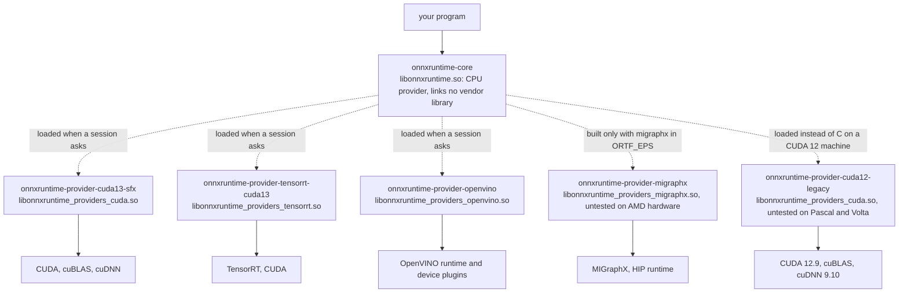

# Engines

How each execution provider ("engine") is packaged and loaded, what it needs at run time, and how to use the library from C, Rust and Python. The recipe's header comment is the reference; the smoke test ([tools/ort-smoke/README.md](../tools/ort-smoke/README.md)) shows what works on a given machine. Terms such as RUNPATH, `dlopen()` and TF32 are in the [glossary](glossary.md). Which hardware each engine covers is in [hardware.md](hardware.md).



## The engines and their packages

Install the packages of the engines you use. Each provider is a separate library, in a separate package, that ONNX Runtime loads only when a session asks for it, and the core library links no vendor runtime.

| Engine (execution provider) | Hardware | This recipe's package | Vendor runtime packages | Provided by |
|---|---|---|---|---|
| CPU | Any x86_64 CPU | `onnxruntime-core` | none | built in |
| CUDA | NVIDIA GPU | `onnxruntime-provider-cuda<M>-<sfx>` | `nvidia-utils`, `cuda`, `cudnn` | Arch `extra` |
| TensorRT | NVIDIA GPU | `onnxruntime-provider-tensorrt-cuda<M>` | TensorRT 11 (and the CUDA package's runtimes) | `nvidia-tensorrt-sdk-local` from the omarchy-nvidia-sdks repository (under `/opt/nvidia/tensorrt`, pkgrel 2 or later), or the AUR's `tensorrt` (under `/usr`) |
| OpenVINO, device `CPU` | Intel CPU | `onnxruntime-provider-openvino` | `openvino` | Arch `extra` |
| OpenVINO, device `GPU` | Intel graphics | `onnxruntime-provider-openvino` | `openvino-intel-gpu-plugin`, `intel-compute-runtime`, `level-zero-loader` | Arch `extra` |
| OpenVINO, device `NPU` | Intel NPU | `onnxruntime-provider-openvino` | `openvino-intel-npu-plugin`, `intel-npu-driver`, `level-zero-loader` | Arch `extra` |
| MIGraphX (untested on AMD hardware) | AMD GPU supported by ROCm | `onnxruntime-provider-migraphx` | `migraphx`, `hip-runtime-amd` | Arch `extra` |

`<M>` is the CUDA major version of the toolkit that built the package (`13`), and `<sfx>` names the GPU architectures ([build.md](build.md#package-names)). To build, `cuda`, `cudnn` and `openvino` must be installed. For the TensorRT provider, TensorRT must be installed from a package, or unpacked by hand and built with `makepkg -d` ([install.md](install.md#2-tensorrt)). For the MIGraphX provider, `migraphx` and `hip-runtime-amd` must be installed. Installing a provider package needs its runtime (a hard dependency); the OpenVINO device plugins and drivers are optional dependencies, installed for the devices you use.

## How the providers load

- **The core.** `libonnxruntime.so` contains the CPU provider and needs only `glibc`, `libgcc` and `libstdc++`. `onnxruntime-core`, which holds it, depends on those packages only and runs CPU-only on its own. `package()` fails the build if the core library or the Python module needs a CUDA, cuDNN, TensorRT, OpenVINO, MIGraphX or HIP library.
- **The providers.** Each other provider is a separate `libonnxruntime_providers_<provider>.so` (beside `libonnxruntime_providers_shared.so`, which is in `onnxruntime-core`), loaded only when a session asks for that provider, and each is in its own package. One build serves every engine because of this: the providers are shared objects that one `libonnxruntime.so` loads at run time, so the split is per engine, unlike Arch's, where each variant is a separate build of the whole library.
- **Dependencies.** A provider package depends on the vendor runtimes its library links, so it cannot be installed without them. It also depends on `onnxruntime-core=<pkgver>-<pkgrel>` (the CUDA 12 legacy package on `onnxruntime-core=<pkgver>`, any pkgrel). The vendor dependencies carry version bounds, so that pacman refuses a vendor upgrade past what the provider was built for until the recipe is rebuilt, instead of leaving a provider that silently fails to load. The policy and the bounds are in [dependencies.md](dependencies.md).
- **Available providers.** `GetAvailableProviders` is fixed when the library is built, from the providers selected by `ORTF_EPS`; it does not show which provider packages are installed. A session that asks for a provider whose package is missing fails when ONNX Runtime loads the provider library, with a "cannot open shared object file" error, which the smoke test reports as `unavailable`. This has not been checked against the split packages on hardware. The Python package's links to the provider libraries dangle until that provider's package is installed.
- **CPU fallback.** A session with a single non-CPU provider falls back to the CPU provider for operators it cannot take, unless you set the session option `session.disable_cpu_ep_fallback=1`. The smoke test sets it so that a provider that cannot take the graph fails loudly.

## CUDA

Package `onnxruntime-provider-cuda<M>-<sfx>`, which depends on the NVIDIA driver (`nvidia-utils`), `cuda` and `cudnn`, and provides `onnxruntime-provider-cuda` and `onnxruntime-provider-cuda<M>` (and so conflicts with them: CUDA packages of different builds install the same library). The recipe targets CUDA 13.x, which is upstream's main GPU line and what Arch's `cuda` ships, and `<M>` in the name is the CUDA major version of the toolkit that built it (`13`).

The provider is compiled for the GPU architectures in `ORTF_CUDA_ARCHS`. The default is the preset `rtx` (`75 86 89 120`, package `-cuda13-rtx`); the preset `all` gives `-cuda13-all`, and a list such as `120` gives `-cuda13-sm120`. A GPU outside that list is not targeted, unless you built a `-virtual` entry for PTX ([build.md](build.md#cuda-architectures) has the presets and sizes). The presets `rtx` and `all` need a CUDA 13 toolkit and are refused with CUDA 12. Cards that CUDA 13 dropped are served by a separate package, `onnxruntime-provider-cuda12-legacy`: [cuda12-legacy.md](cuda12-legacy.md).

## TensorRT

Package `onnxruntime-provider-tensorrt-cuda<M>`, which depends on the CUDA package of the same major version (`onnxruntime-provider-cuda<M>`, the name every CUDA package provides; it links that CUDA's runtime), on `cuda`, `cudnn` and `nvidia-utils`, and on `tensorrt`, which is TensorRT 11, bounded to the major.minor of the headers the build used. Either TensorRT source provides that name: `nvidia-tensorrt-sdk-local` from omarchy-nvidia-sdks (under `/opt/nvidia/tensorrt`, from its pkgrel 2) or the AUR's `tensorrt` (under `/usr`); see [install.md](install.md#2-tensorrt). The recipe takes its TensorRT from those same two places, see [build.md](build.md#tensorrt-location). The package provides `onnxruntime-provider-tensorrt`, the name `onnxruntime-core`'s optional dependencies use. It has no architecture suffix: its library holds no GPU code, because TensorRT builds its kernels at run time.

- **Library path.** `package()` sets the RUNPATH of `libonnxruntime_providers_tensorrt.so` with `patchelf` in every build that has TensorRT, so the provider finds `libnvinfer` and `libnvonnxparser` without an `ld.so.conf` entry and without `LD_LIBRARY_PATH`. The RUNPATH is `/opt/nvidia/tensorrt/lib`, preceded by the library directory of the build's TensorRT when that is neither `/usr/lib` nor `/usr/lib64`; the default search then covers `/usr/lib`, where the AUR's `tensorrt` installs. Nothing is global. The RUNPATH names `/opt` even for a build against `/usr`, because the package depends on the name `tensorrt`, which either source satisfies. So when both TensorRTs are installed, the one under `/opt` is loaded, whichever the build used, unless `LD_LIBRARY_PATH` names another.
- **Built-in plugins.** TensorRT's plugin library, `libnvinfer_plugin.so.<major>`, is not covered by that RUNPATH. ONNX Runtime opens it by name with `dlopen` from inside `libonnxruntime.so`, and `dlopen` searches the RUNPATH of the object that calls it. That is `libonnxruntime.so`'s own RUNPATH, `$ORIGIN`, the directory it is installed in (`/usr/lib`), not the provider's. So the plugin library is found under `/usr/lib`, where the AUR's `tensorrt` installs its libraries, but not under `/opt/nvidia/tensorrt/lib`. A program that needs TensorRT's built-in plugins from `/opt` therefore runs with TensorRT's `lib/` on `LD_LIBRARY_PATH`, for example by loading the environment file of the TensorRT package: `EnvironmentFile=/usr/share/nvidia-tensorrt/nvidia-tensorrt.env` in a systemd unit, or `set -a; . /usr/share/nvidia-tensorrt/nvidia-tensorrt.env; set +a` in a shell. Without it the provider still works and logs that the default plugin library was not found. This follows from the loader's rules and has **not been verified on hardware**; the smoke test cannot show it either, because its model needs no plugin.
- **Environment file scope.** The file sets `LD_LIBRARY_PATH` for the program that loads it. Load it for that program only, not from a login profile.
- **TF32.** TensorRT, like CUDA, runs convolutions and matrix products in TF32 by default on GPUs that have it. ONNX Runtime 1.29 has no TensorRT provider option for it; set `NVIDIA_TF32_OVERRIDE=0` in the program's environment, before ONNX Runtime loads, for full fp32 arithmetic. The environment variable also applies to the CUDA provider. The effect on a model's output is in [results.md](results.md#reading-the-figures).
- **Engine building.** The smoke test runs the provider with its engine cache off, and reports that creating the session, which includes building the engine, takes seconds. A larger model takes longer on the first session.

## OpenVINO

Package `onnxruntime-provider-openvino`, which depends on `openvino`, bounded to the year.minor installed at build time. The provider selects a device with `device_type`: `CPU`, `GPU` or `NPU`. The runtime must be OpenVINO 2026.0 or newer, which the recipe builds against. The packages for the GPU and NPU devices are optional dependencies of this package, because each device needs only its own; with a device missing, ONNX Runtime reports `Device <name> is not available`.

| `device_type` | Packages | Also |
|---|---|---|
| `CPU` | `openvino` | |
| `GPU` | `openvino-intel-gpu-plugin`, `intel-compute-runtime`, `level-zero-loader` | access to the GPU's render node |
| `NPU` | `openvino-intel-npu-plugin`, `intel-npu-driver`, `level-zero-loader` | the kernel's `intel_vpu` driver and access to `/dev/accel/accel0` |

Some accelerators, NPUs among them, need static shapes; the smoke test's model has them. See [install.md](install.md#1-prerequisites) for the device checks.

- **Precision on GPU and NPU.** The Intel GPU and NPU devices infer in fp16 by default, so their outputs differ from the CPU's by more than fp32 rounding on deep models ([results.md](results.md)). On the GPU, the OpenVINO EP's `precision=FP32` option had no effect on the output with this build and OpenVINO 2026.4.1: the results were identical to the default's. The `load_config` option `{"GPU": {"INFERENCE_PRECISION_HINT": "f32"}}` did give fp32 results; see [Precision modes](../tools/ort-model-check/README.md#precision-modes). The NPU has no fp32 inference.
- **Releasing the environment crashes at process exit.** With ONNX Runtime 1.29.0 and OpenVINO 2026.4.1, a program that releases the ONNX Runtime environment after using the OpenVINO provider crashed at exit with `SIGSEGV`, although every inference had succeeded. This affects the C API (`ReleaseEnv`) and any binding that releases the environment. Releasing the environment unloads `libonnxruntime_providers_openvino.so` and, with it, OpenVINO's CPU plugin, while OpenVINO worker threads and thread-local destructors still run code from them. Keep the environment for the life of the process and do not release it at exit. The Python module never releases its environment and is not affected. Details: [tools/ort-smoke/README.md](../tools/ort-smoke/README.md#process-exit-with-openvino).

## MIGraphX

The AMD GPU provider, built on request and untested on AMD hardware: [amd.md](amd.md).

## Hardware coverage and what is not packaged

Which hardware each engine covers, what is deliberately left out, and why: [hardware.md](hardware.md). It holds the status table (packaged, planned, untested, not packaged) for NVIDIA, Intel and AMD hardware and for the Ryzen AI NPU.

### NVIDIA

See [hardware.md](hardware.md#nvidia).

### NVIDIA Pascal and Volta (CUDA 12 legacy; packaged, untested)

See [cuda12-legacy.md](cuda12-legacy.md) (and [hardware.md](hardware.md#nvidia-pascal-and-volta-cuda-12-legacy-packaged-untested)).

### Intel (OpenVINO provider)

See [hardware.md](hardware.md#intel-openvino-provider).

### AMD GPUs (MIGraphX; packaged, untested)

See [amd.md](amd.md), and [hardware.md](hardware.md#amd-gpus-migraphx-packaged-untested).

### AMD Ryzen AI NPU (Vitis AI provider; not packaged)

See [hardware.md](hardware.md#amd-ryzen-ai-npu-vitis-ai-provider-not-packaged).

## Using the library

The packages install:

| Path | Package | Content |
|---|---|---|
| `/usr/lib/libonnxruntime.so`, `.so.1`, `.so.1.29.0` | `onnxruntime-core` | The core library with the CPU provider |
| `/usr/lib/libonnxruntime_providers_shared.so` | `onnxruntime-core` | Shared by the other providers; present in a build with any of them |
| `/usr/lib/libonnxruntime_providers_<provider>.so` | the provider's package | One library per provider built |
| `/usr/include/onnxruntime/` | `onnxruntime-core` | The C and C++ API headers |
| `/usr/lib/pkgconfig/libonnxruntime.pc` and the CMake files | `onnxruntime-core` | pkg-config and CMake files |
| `/usr/share/licenses/<package>/` | every package | ONNX Runtime's licence and third-party notices, and cpuinfo's and protobuf's licences (the CUDA package also cudnn-frontend's) |

### From C and C++

```bash
cc app.c $(pkg-config --cflags --libs libonnxruntime) -o app
```

The headers are in `/usr/include/onnxruntime`, so a program includes `<onnxruntime_c_api.h>` or `<onnxruntime_cxx_api.h>` with the flags above. [tools/ort-smoke/smoke.c](../tools/ort-smoke/smoke.c) is a complete small C example, including how to append the CUDA, TensorRT and OpenVINO providers (it does not cover MIGraphX). It uses the C API only.

### From Rust

With the `ort` crate, use its `load-dynamic` feature so that the crate loads the installed library instead of downloading one:

```bash
ORT_DYLIB_PATH=/usr/lib/libonnxruntime.so ./your-program
```

Because the library is the same API version as Arch's `onnxruntime` package, a program built against that package works with this one.

### From Python

`python-onnxruntime-core` (which depends on `onnxruntime-core`) installs the `onnxruntime` module into the system Python's site-packages, with `libonnxruntime.so` and the provider libraries linked to those in `/usr/lib`. The link to a provider library works once that provider's package is installed:

```bash
python -c "import onnxruntime as ort; print(ort.__version__, ort.get_available_providers())"
```

It is for the system's `/usr/bin/python`; a virtual environment with its own `onnxruntime` wheel does not use these libraries.

A program that wants TensorRT's built-in plugins also loads the TensorRT environment file ([TensorRT](#tensorrt)).
