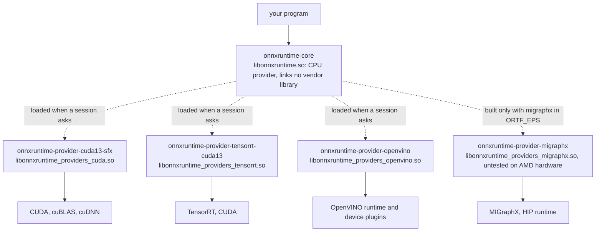

# Engines

How each execution provider is built, packaged and loaded, what it needs at run time, and how to use the library from C, Rust and Python. The recipe's header comment is the reference; the smoke test ([tools/ort-smoke/README.md](../tools/ort-smoke/README.md)) shows what works on a given machine.



## How the providers load

- `libonnxruntime.so` contains the CPU provider and needs only `glibc`, `libgcc` and `libstdc++`; `onnxruntime-core`, which holds it, depends on those packages only and runs CPU-only on its own. `package()` fails the build if the core library or the Python module needs a CUDA, cuDNN, TensorRT, OpenVINO, MIGraphX or HIP library.
- Each other provider is a separate `libonnxruntime_providers_<provider>.so` (with `libonnxruntime_providers_shared.so`, which is in `onnxruntime-core`), loaded only when a session asks for that provider, and each is in its own package. One build serves every engine because of this: the providers are shared objects that one `libonnxruntime.so` loads at run time, so the split is per engine, unlike Arch's, where each variant is a separate build of the whole library.
- A provider package **depends** on the vendor runtimes its library links, so it cannot be installed without them. `package()` reads the library's `DT_NEEDED` entries and fails the build for a library that is neither a system library nor mapped to a package in that package's `depends`: the CUDA package depends on `cuda`, `cudnn` and `nvidia-utils`, the TensorRT package on the same plus `tensorrt`, the OpenVINO package on `openvino`, and the MIGraphX package on `migraphx` and `hip-runtime-amd`. The provider packages also depend on `onnxruntime-core=<pkgver>-<pkgrel>`. The dependencies on the vendor runtimes carry version bounds: `cuda` by major version, from the soname (`libcudart.so.13` gives `cuda>=13` and `cuda<14`); `cudnn` by major version from the cuDNN installed at build time (`CUDNN_MAJOR` in `cudnn_version.h`), because the real CUDA provider `dlopen()`s cuDNN and has no `libcudnn` in its `DT_NEEDED` entries; `tensorrt` by major.minor, because its ABI is sensitive to the minor version; `openvino` by year.minor; `migraphx` and `hip-runtime-amd` by the major version of the installed package. The TensorRT bound comes from the `NvInferVersion.h` of the TensorRT the build used, and the OpenVINO, MIGraphX and HIP bounds from the versions installed when the package was built (ROCm's sonames do not change across its majors, so they give no bound; see [AMD GPUs](#amd-gpus-migraphx-packaged-untested)). The `DT_NEEDED` check (and `scripts/check-deps.sh`) does not see libraries a provider `dlopen()`s: `libcuda`, `libnvrtc` and `libcufft` are covered by `nvidia-utils` and the `cuda` bound, cuDNN by the recorded bound, instead of by what the library links. A vendor upgrade past a bound is therefore refused by pacman until this recipe is rebuilt, instead of leaving a provider that silently fails to load. The full policy and `scripts/check-deps.sh`, which shows when a rebuild is due, are in [install.md](install.md#dependencies-and-version-bounds).
- `GetAvailableProviders` is fixed when the library is built, from the providers selected by `ORTF_EPS`; it does not show which provider packages are installed. A session that asks for a provider whose package is missing fails when ONNX Runtime loads the provider library, with a "cannot open shared object file" error, which the smoke test reports as `unavailable`. This has not been checked against the split packages on hardware. The Python package's links to the provider libraries dangle until that provider's package is installed.
- A session with a single non-CPU provider falls back to the CPU provider for operators it cannot take, unless you set the session option `session.disable_cpu_ep_fallback=1`; the smoke test sets it so that a provider that cannot take the graph fails loudly.

## CUDA

Package `onnxruntime-provider-cuda<M>-<sfx>`, which depends on the NVIDIA driver (`nvidia-utils`), `cuda` and `cudnn`, and provides `onnxruntime-provider-cuda` and `onnxruntime-provider-cuda<M>` (and so conflicts with them: CUDA packages of different builds install the same library). The recipe targets CUDA 13.x, which is upstream's main GPU line and what Arch's `cuda` ships, and `<M>` in the name is the CUDA major version of the toolkit that built it (`13`). The provider is compiled for the GPU architectures in `ORTF_CUDA_ARCHS` (default the preset `rtx`, `75 86 89 120`, package `-cuda13-rtx`; the preset `all` gives `-cuda13-all`, and a list such as `120` gives `-cuda13-sm120`): a GPU outside that list is not targeted, unless you built a `-virtual` entry for PTX ([build.md](build.md#cuda-architectures); sizes in the [README](../README.md#cuda-architecture-presets)). A CUDA 12 variant is on the backlog and not provided at present.

## TensorRT

Package `onnxruntime-provider-tensorrt-cuda<M>`, which depends on the CUDA package of the same major version (`onnxruntime-provider-cuda<M>`, the name every CUDA package provides; it links that CUDA's runtime), on `cuda`, `cudnn` and `nvidia-utils`, and on `tensorrt`, which is TensorRT 11, bounded to the major.minor of the headers the build used. Either TensorRT source provides that name: `nvidia-tensorrt-sdk-local` from omarchy-nvidia-sdks (under `/opt/nvidia/tensorrt`, from its pkgrel 2) or the AUR's `tensorrt` (under `/usr`). The recipe takes its TensorRT from those same two places, see [build.md](build.md#tensorrt-location). It provides `onnxruntime-provider-tensorrt`, the name `onnxruntime-core`'s optional dependencies use. The package has no architecture suffix: its library holds no GPU code, because TensorRT builds its kernels at run time.

- **Library path.** `package()` sets the RUNPATH of `libonnxruntime_providers_tensorrt.so` with `patchelf` in every build that has TensorRT, so the provider finds `libnvinfer` and `libnvonnxparser` without an `ld.so.conf` entry and without `LD_LIBRARY_PATH`. The RUNPATH is `/opt/nvidia/tensorrt/lib`, preceded by the library directory of the build's TensorRT when that is neither `/usr/lib` nor `/usr/lib64`; the default search then covers `/usr/lib`, where the AUR's `tensorrt` installs. Nothing is global. The RUNPATH names `/opt` even for a build against `/usr`, because the package depends on the name `tensorrt`, which either source satisfies. So when both TensorRTs are installed, the one under `/opt` is loaded, whichever the build used, unless `LD_LIBRARY_PATH` names another.
- **Built-in plugins.** TensorRT's plugin library, `libnvinfer_plugin.so.<major>`, is not covered by that RUNPATH. ONNX Runtime opens it by name with `dlopen` from inside `libonnxruntime.so`, and `dlopen` searches the RUNPATH of the object that calls it. That is `libonnxruntime.so`'s own RUNPATH, `$ORIGIN`, the directory it is installed in (`/usr/lib`), not the provider's. So the plugin library is found under `/usr/lib`, where the AUR's `tensorrt` installs its libraries, but not under `/opt/nvidia/tensorrt/lib`. A program that needs TensorRT's built-in plugins from `/opt` therefore runs with TensorRT's `lib/` on `LD_LIBRARY_PATH`, for example by loading the environment file of the TensorRT package: `EnvironmentFile=/usr/share/nvidia-tensorrt/nvidia-tensorrt.env` in a systemd unit, or `set -a; . /usr/share/nvidia-tensorrt/nvidia-tensorrt.env; set +a` in a shell. Without it the provider still works and logs that the default plugin library was not found. This follows from the loader's rules and has **not been verified on hardware**; the smoke test cannot show it either, because its model needs no plugin.
- **Environment file scope.** The file sets `LD_LIBRARY_PATH` for the program that loads it. Load it for that program only, not from a login profile.
- **TF32.** TensorRT, like CUDA, runs convolutions and matrix products in TF32 by default on GPUs that have it. ONNX Runtime 1.29 has no TensorRT provider option for it; set `NVIDIA_TF32_OVERRIDE=0` in the program's environment, before ONNX Runtime loads, for full fp32 arithmetic. The environment variable also applies to the CUDA provider. The effect on a model's output is in [results.md](results.md).
- **Engine building.** The smoke test runs the provider with its engine cache off, and reports that creating the session, which includes building the engine, takes seconds. A larger model takes longer on the first session.

## OpenVINO

Package `onnxruntime-provider-openvino`, which depends on `openvino`, bounded to the year.minor installed at build time. The provider selects a device with `device_type`: `CPU`, `GPU` or `NPU`. The runtime must be OpenVINO 2026.0 or newer, which the recipe builds against. The packages for the GPU and NPU devices are optional dependencies of this package, because each device needs only its own; with a device missing, ONNX Runtime reports `Device <name> is not available`.

| `device_type` | Packages | Also |
|---|---|---|
| `CPU` | `openvino` | |
| `GPU` | `openvino-intel-gpu-plugin`, `intel-compute-runtime`, `level-zero-loader` | access to the GPU's render node |
| `NPU` | `openvino-intel-npu-plugin`, `intel-npu-driver`, `level-zero-loader` | the kernel's `intel_vpu` driver and access to `/dev/accel/accel0` |

Some accelerators, NPUs among them, need static shapes; the smoke test's model has them. See [install.md](install.md#1-prerequisites) for the device checks.

- **Precision on GPU and NPU.** The Intel GPU and NPU devices infer in fp16 by default, so their outputs differ from the CPU's by more than fp32 rounding on deep models ([results.md](results.md)). On the GPU, the OpenVINO EP's `precision=FP32` option had no effect on the output with this build and OpenVINO 2026.4.1: the results were identical to the default's. The `load_config` option `{"GPU": {"INFERENCE_PRECISION_HINT": "f32"}}` did give fp32 results; see [Precision modes](../tools/ort-model-check/README.md#precision-modes). The NPU has no fp32 inference.
- **Releasing the environment crashes at process exit.** With ONNX Runtime 1.29.0 and OpenVINO 2026.4.1, a program that releases the ONNX Runtime environment after using the OpenVINO provider crashed at exit with `SIGSEGV`, although every inference had succeeded. This affects the C API (`ReleaseEnv`) and any binding that releases the environment. Releasing the environment unloads `libonnxruntime_providers_openvino.so` and, with it, OpenVINO's CPU plugin, while OpenVINO worker threads and thread-local destructors still run code from them. Keep the environment for the life of the process and do not release it at exit. The Python module never releases its environment and is not affected. Details: [tools/ort-smoke/README.md](../tools/ort-smoke/README.md#process-exit-with-openvino).

## Hardware coverage and what is not packaged

Which hardware each engine covers, what is deliberately left out, and why. Status words are used strictly: **packaged** means the recipe builds it; **planned** means it is intended and not built yet; **untested** means the recipe builds it but it has never run on that hardware; **not packaged** means there is no plan. Hardware lists reflect the vendors' documentation in November 2026 and change with each release, so check the linked sources for your card or CPU.

| Hardware | Status |
|---|---|
| NVIDIA Turing (RTX 20, GTX 16) and newer | packaged (CUDA 13, [presets](../README.md#cuda-architecture-presets)) |
| NVIDIA Maxwell, Pascal, Volta | planned: a CUDA 12 variant, not built yet |
| Intel CPUs, Xe and Arc GPUs, NPUs | packaged (OpenVINO provider) |
| Intel Gen8, Gen9 and Gen11 integrated GPUs | possible with a legacy driver you install yourself; unverified |
| Intel oneDNN provider | not packaged |
| AMD GPUs supported by ROCm (gfx1030 and newer, Instinct) | packaged on request (`ORTF_EPS=migraphx`, MIGraphX provider), untested on AMD hardware |
| AMD Vega and Polaris GPUs | not supported |
| AMD Ryzen AI NPU (Vitis AI provider) | not packaged |

### NVIDIA

The CUDA provider is built with CUDA 13, which is what Arch's `cuda` ships. CUDA 13 dropped GPUs older than Turing, so the architecture presets start at `sm_75`: `rtx` (`75 86 89 120`, the default) and `all` (`75 80 86 89 90 100 103 120`), or a list of your own, such as `120` for the RTX 50 series alone ([presets and sizes](../README.md#cuda-architecture-presets), [build input](build.md#cuda-architectures)).

Cards older than Turing, namely Maxwell (`sm_50`, `sm_52`), Pascal (`sm_60`, `sm_61`) and Volta (`sm_70`), need a CUDA 12 build. A variant `onnxruntime-provider-cuda12-<preset>` is planned and **not built yet**; there is no estimate for it. It needs:

- the CUDA 12.9 toolkit installed beside CUDA 13 (Arch ships only CUDA 13);
- the cuDNN 9 build for CUDA 12;
- TensorRT 10, because TensorRT 11 needs CUDA 13 (for the TensorRT provider);
- gcc 14 as the host compiler;
- on the machine that runs it, the CUDA 12 runtime and the legacy 580 driver series, the last that supports these GPUs.

It would conflict with the CUDA 13 provider package, which installs the same library file. It cannot be tested on the maintainer's hardware, so it would be marked untested until someone confirms it on an old card. Whether ONNX Runtime 1.29 itself still targets Maxwell has not been checked. Sources: [CUDA GPU compute capabilities](https://developer.nvidia.com/cuda-gpus), [ONNX Runtime CUDA provider requirements](https://onnxruntime.ai/docs/execution-providers/CUDA-ExecutionProvider.html).

### Intel (OpenVINO provider)

The OpenVINO provider has no per-device build: the one package serves every Intel device, and OpenVINO's device plugins decide what runs where. What a device can run is set by OpenVINO and by the driver for that device. From OpenVINO 2026.4's [system requirements](https://github.com/openvinotoolkit/openvino/blob/2026.4.1/docs/articles_en/about-openvino/release-notes-openvino/system-requirements.rst):

| Device (`device_type`) | Supported hardware | Packages for the device |
|---|---|---|
| `CPU` | Core Ultra series 1, 2 and 3; 6th to 14th generation Core; Xeon 6; 1st to 5th generation Xeon Scalable; Atom; Pentium N series | `openvino` |
| `GPU` | Integrated graphics from Tiger Lake (Iris Xe) through Rocket Lake, Alder Lake, Raptor Lake, Meteor Lake, Arrow Lake, Lunar Lake and Panther Lake; Arc Alchemist and Battlemage; Data Center GPU Flex and Max | `openvino-intel-gpu-plugin`, `intel-compute-runtime`, `level-zero-loader` |
| `NPU` | Core Ultra with an NPU: Meteor Lake, Arrow Lake, Lunar Lake, Panther Lake and Wildcat Lake | `openvino-intel-npu-plugin`, `intel-npu-driver`, `level-zero-loader`, and the kernel's `intel_vpu` driver |

The NPU generations are those of Intel's [Linux NPU driver](https://github.com/intel/linux-npu-driver/blob/main/docs/overview.md); the GPU generations are those of Intel's [compute runtime](https://github.com/intel/compute-runtime). OpenVINO lists Ubuntu and RHEL as tested systems, not Arch; the Arch packages are what this recipe was checked with ([results](results.md)).

**Older integrated GPUs (Gen8, Gen9, Gen11).** Intel's current compute runtime, which is Arch's `intel-compute-runtime`, no longer supports Broadwell, Skylake to Coffee Lake, Ice Lake and the Apollo, Gemini and Elkhart Lake parts. Intel moved them to a separate legacy branch, which Arch does not package. The AUR has `intel-compute-runtime-legacy` for it; install it yourself in place of `intel-compute-runtime`. Whether OpenVINO 2026 still runs on those GPUs with that driver is **unverified**, and this recipe does not test it. The CPU device works on those machines whatever the GPU.

**oneDNN provider: not packaged.** ONNX Runtime also has a oneDNN execution provider. Its documentation lists a CPU backend only (a GPU path needs a separate OpenCL build), and it adds little over ONNX Runtime's own CPU provider and OpenVINO's CPU device, so the recipe leaves it out. Source: [oneDNN execution provider](https://onnxruntime.ai/docs/execution-providers/oneDNN-ExecutionProvider.html).

### AMD GPUs (MIGraphX; packaged, untested)

**There is no ROCm execution provider in ONNX Runtime 1.29.** It was removed in 1.23, whose release notes point AMD users to the MIGraphX and Vitis AI providers ([1.23 release notes](https://newreleases.io/project/pypi/onnxruntime/release/1.23.0), [MIGraphX provider documentation](https://onnxruntime.ai/docs/execution-providers/MIGraphX-ExecutionProvider.html)). The source tree at `v1.29.0` has no ROCm build option. Arch's `onnxruntime-rocm` and `onnxruntime-opt-rocm` still pass ROCm-related flags (a HIP architecture list, HIP and NCCL settings), but they are inert in 1.29: the built package holds only the MIGraphX, oneDNN and shared provider libraries and no HIP code ([Arch recipe](https://gitlab.archlinux.org/archlinux/packaging/packages/onnxruntime/-/blob/main/PKGBUILD)). Those packages are therefore, in effect, the MIGraphX provider plus the oneDNN provider.

MIGraphX is the only AMD GPU provider. It is a thin layer, and it **contains no GPU code compiled for a specific card**: it hands the model to the MIGraphX library, which compiles it for the detected GPU when the session is created (the first session is slow; `ORT_MIGRAPHX_MODEL_CACHE_PATH` enables a compiled-model cache). The per-GPU code is in Arch's `migraphx`, `rocblas` and `miopen-hip` packages, built for the GPU list of Arch's ROCm toolchain. So GPU coverage is whatever Arch's ROCm packages were built for, not anything in this recipe, and an architecture preset like CUDA's would produce identical packages.

**Status: packaged, built by `ORTF_EPS=migraphx`, and untested on AMD hardware** (the maintainer has none). The package recipe exists but has not been built yet, so the build itself has had no trial run. The package is `onnxruntime-provider-migraphx`:

- **Build.** `ORTF_EPS=migraphx makepkg -d -f` builds the core and this package (and the Python package). `-d` is needed because `cuda`, `cudnn` and `openvino` are unconditional `makedepends`; install `migraphx` and `hip-runtime-amd` from Arch's `extra` first, and `prepare()` checks the ROCm install under `/opt/rocm`. `ORTF_EPS='cuda tensorrt openvino migraphx' makepkg -s -f` builds every provider: nothing in the 1.29 build files makes them exclusive, but the combination has not been tried. `migraphx` and `hip-runtime-amd` are added to `makedepends` only when `migraphx` is selected. The build passes `-Donnxruntime_USE_MIGRAPHX=ON -Donnxruntime_MIGRAPHX_HOME=/opt/rocm` and nothing else. Whether configuration needs more (`rocm-llvm`, `rocm-device-libs`, `rocm-cmake`) is **unverified** until a trial build. The install is large: `migraphx`, `rocblas` and `miopen-hip` together are several GiB installed.
- **Name and suffix.** No architecture suffix (it holds no GPU code), and no ROCm version in the name: ROCm 7.2 and 10.1 keep the same sonames (`libmigraphx_c.so.3`, `libamdhip64.so.7`). A suffix would be added only if those sonames change.
- **Dependencies.** `onnxruntime-core=<pkgver>-<pkgrel>`, `glibc`, `libgcc`, `libstdc++`, `migraphx` and `hip-runtime-amd`, never `rocm-hip-sdk`. `migraphx` and `hip-runtime-amd` are bounded at package time to the major version of the installed package (`migraphx` 7.2.3 gives `>=7` and `<8`). The sonames are checked against the ones the build linked but give no bound, because they outlast ROCm's majors. Upgrading ROCm across a major (7.2 to 10.1) therefore needs a rebuild, and pacman refuses the upgrade until then.
- **Python.** `onnxruntime-core` and `python-onnxruntime-core` list the package as an optional dependency. The Python module reaches the CUDA, TensorRT and OpenVINO libraries through symlinks from `<site-packages>/onnxruntime/capi/` to `/usr/lib/`, which `python-onnxruntime-core` installs. The MIGraphX link is installed by this package instead, only when the build also makes `python-onnxruntime-core`: `<site-packages>/onnxruntime/capi/libonnxruntime_providers_migraphx.so -> /usr/lib/libonnxruntime_providers_migraphx.so`. It belongs here because upstream's `setup.py` puts the MIGraphX library into the wheel only with `--use_migraphx`, so the Python package does not carry it. Python use of the provider is untested on AMD hardware, like the rest of the package.
- **Smoke test.** The smoke test has no MIGraphX target, so the package has no check in this repository beyond the recipe's own.

Officially supported GPUs are AMD's to define, and Arch is not one of AMD's supported distributions, so on Arch the practical test is "works if Arch's package was built for it". AMD's lists, for the ROCm versions Arch has ([system requirements](https://rocm.docs.amd.com/projects/install-on-linux/en/latest/reference/system-requirements.html), [compatibility matrix](https://rocm.docs.amd.com/en/latest/compatibility/compatibility-matrix.html)):

| GPU generation (gfx) | ROCm 7.2 (Arch `extra`) | ROCm 10.1 (Arch `extra-testing`) |
|---|---|---|
| RDNA 4: RX 9060 and 9070 series, AI PRO R9700 (gfx1200, gfx1201) | supported | supported |
| RDNA 3: RX 7900, 7800 and 7700 series, PRO W7000 (gfx1100, gfx1101) | supported | supported |
| RDNA 3: RX 7600 (gfx1102) | community | supported |
| RDNA 2: RX 6800 and 6900, PRO W6800 (gfx1030) | supported for PRO cards; consumer cards community | supported as PRO W6000 |
| RDNA 2: other RX 6000 (gfx1031, gfx1032) | community | community |
| APUs: Radeon 780M (gfx1103), Strix Point, Strix Halo, Krackan (gfx1150 to gfx1153) | community | supported (Ryzen APU, Ryzen AI) |
| Instinct MI100, MI200, MI300, MI350 (gfx908, gfx90a, gfx942, gfx950) | supported | supported |

"Community" means AMD does not list the GPU but Arch builds code for it, so it often works without AMD's support. The product names beside each gfx code are given for orientation; the codes are authoritative.

**Old AMD GPUs are not supported.** Vega (gfx900), Radeon VII and MI50 (gfx906) and Polaris (gfx803) are outside current ROCm, and ROCm decides support. Running them would need an old ONNX Runtime (1.22 or earlier, the last with the ROCm provider) against an old ROCm (5.x or 6.x) that Arch no longer ships. This recipe does not provide that and documents these GPUs as unsupported. Besides this recipe's MIGraphX package, an AMD GPU can use Arch's `onnxruntime-rocm` or `onnxruntime-opt-rocm`, which carry the MIGraphX provider. `onnxruntime-core` conflicts with both, so pacman removes one when you install the other.

### AMD Ryzen AI NPU (Vitis AI provider; not packaged)

ONNX Runtime's Vitis AI provider is not packaged. The in-tree provider is a shim: the working implementation is a proprietary AMD library loaded at run time, and ONNX Runtime documents the Linux build of the provider only for AMD's embedded Adaptable SoCs ([build documentation](https://onnxruntime.ai/docs/build/eps.html), [provider documentation](https://onnxruntime.ai/docs/execution-providers/Vitis-AI-ExecutionProvider.html)).

Using a Ryzen AI NPU on Linux needs AMD's own [Ryzen AI Software](https://ryzenai.docs.amd.com/en/latest/linux.html): a download that requires accepting AMD's licence, delivered as a tarball for Ubuntu 24.04, with its own ONNX Runtime build, for Strix Point and newer. It cannot be redistributed, and this repository does not redistribute vendor files. Supporting it would take a separate recipe repository that builds from the user's own download, as [omarchy-nvidia-sdks](https://github.com/rsd/omarchy-nvidia-sdks) does for NVIDIA's SDKs.

On the Arch side, the kernel driver `amdxdna` is in the mainline kernel, and `xrt` and `xrt-plugin-amdxdna` are in Arch's `extra` repository.

## Using the library

The packages install:

| Path | Package | Content |
|---|---|---|
| `/usr/lib/libonnxruntime.so`, `.so.1`, `.so.1.29.0` | `onnxruntime-core` | The core library with the CPU provider |
| `/usr/lib/libonnxruntime_providers_shared.so` | `onnxruntime-core` | Shared by the other providers; present in a build with any of them |
| `/usr/lib/libonnxruntime_providers_<provider>.so` | the provider's package | One library per provider built |
| `/usr/include/onnxruntime/` | `onnxruntime-core` | The C and C++ API headers |
| `/usr/lib/pkgconfig/libonnxruntime.pc` and the CMake files | `onnxruntime-core` | pkg-config and CMake files |
| `/usr/share/licenses/<package>/` | every package | ONNX Runtime's licence and third-party notices, and cpuinfo's and protobuf's licences (the CUDA package also cudnn-frontend's) |

### From C and C++

```bash
cc app.c $(pkg-config --cflags --libs libonnxruntime) -o app
```

The headers are in `/usr/include/onnxruntime`, so a program includes `<onnxruntime_c_api.h>` or `<onnxruntime_cxx_api.h>` with the flags above. [tools/ort-smoke/smoke.c](../tools/ort-smoke/smoke.c) is a complete small C example, including how to append the CUDA, TensorRT and OpenVINO providers (it does not cover MIGraphX). It uses the C API only.

### From Rust

With the `ort` crate, use its `load-dynamic` feature so that the crate loads the installed library instead of downloading one:

```bash
ORT_DYLIB_PATH=/usr/lib/libonnxruntime.so ./your-program
```

Because the library is the same API version as Arch's `onnxruntime` package, a program built against that package works with this one.

### From Python

`python-onnxruntime-core` (which depends on `onnxruntime-core`) installs the `onnxruntime` module into the system Python's site-packages, with `libonnxruntime.so` and the provider libraries linked to those in `/usr/lib`. The link to a provider library works once that provider's package is installed:

```bash
python -c "import onnxruntime as ort; print(ort.__version__, ort.get_available_providers())"
```

It is for the system's `/usr/bin/python`; a virtual environment with its own `onnxruntime` wheel does not use these libraries.

A program that wants TensorRT's built-in plugins also loads the TensorRT environment file ([TensorRT](#tensorrt)).
