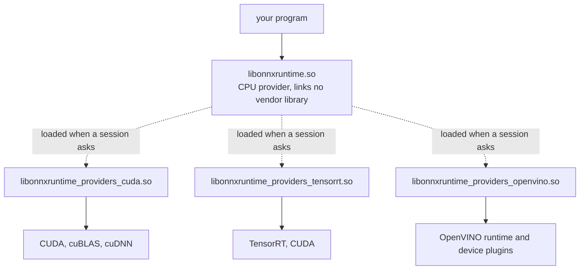

# Engines

How each execution provider is built and loaded, what it needs at run time, and how to use the library from C, Rust and Python. The recipe's header comment is the reference; the smoke test ([tools/ort-smoke/README.md](../tools/ort-smoke/README.md)) shows what works on a given machine.



## How the providers load

- `libonnxruntime.so` contains the CPU provider and needs only `glibc`, `libgcc`, `libstdc++` and `zlib`. `package()` fails the build if it, or the Python module, needs a CUDA, cuDNN, TensorRT or OpenVINO library. That is why the vendor runtimes are optional dependencies and not dependencies.
- Each other provider is a separate `libonnxruntime_providers_<provider>.so` (with `libonnxruntime_providers_shared.so`), loaded only when a session asks for that provider. A missing vendor runtime therefore disables that provider and nothing else.
- The package compiles in every provider selected by `ORTF_EPS` whether or not the runtime is installed on the machine that uses it. `GetAvailableProviders` lists them all, and a provider whose runtime is missing fails when a session asks for it, with a "cannot open shared object file" error. The smoke test reports that case as `unavailable`.
- A session with a single non-CPU provider falls back to the CPU provider for operators it cannot take, unless you set the session option `session.disable_cpu_ep_fallback=1`; the smoke test sets it so that a provider that cannot take the graph fails loudly.

## CUDA

Needs the NVIDIA driver (`nvidia-utils`), `cuda` and `cudnn`. The recipe targets CUDA 13.x, which is upstream's main GPU line and what Arch's `cuda` ships. The provider is compiled for the GPU architectures in `ORTF_CUDA_ARCHS` (default `120`): a GPU outside that list is not targeted, unless you built a `-virtual` entry for PTX ([build.md](build.md#cuda-architectures)).

## TensorRT

Needs everything the CUDA provider needs, plus TensorRT 11. The recipe takes TensorRT from `/opt/nvidia/tensorrt` (the omarchy-nvidia-sdks package) or `/usr` (the AUR's `tensorrt`), see [build.md](build.md#tensorrt-location).

- **Library path.** When TensorRT is outside `/usr/lib` and `/usr/lib64`, `package()` adds its `lib` directory to the RUNPATH of `libonnxruntime_providers_tensorrt.so` with `patchelf`, so the provider finds `libnvinfer` and `libnvonnxparser` without an `ld.so.conf` entry and without `LD_LIBRARY_PATH`. Nothing is global.
- **Built-in plugins.** TensorRT's plugin library, `libnvinfer_plugin.so.<major>`, is not covered by that RUNPATH. ONNX Runtime opens it by name with `dlopen` from inside `libonnxruntime.so`, and `dlopen` searches the RUNPATH of the object that calls it; `libonnxruntime.so` has none. A program that needs TensorRT's built-in plugins therefore runs with TensorRT's `lib/` on `LD_LIBRARY_PATH`, for example by loading the environment file of the TensorRT package: `EnvironmentFile=/usr/share/nvidia-tensorrt/nvidia-tensorrt.env` in a systemd unit, or `set -a; . /usr/share/nvidia-tensorrt/nvidia-tensorrt.env; set +a` in a shell. Without it the provider still works and logs that the default plugin library was not found. This follows from the loader's rules and has **not been verified on hardware**; the smoke test cannot show it either, because its model needs no plugin.
- **Environment file scope.** The file sets `LD_LIBRARY_PATH` for the program that loads it. Load it for that program only, not from a login profile.
- **Engine building.** The smoke test runs the provider with its engine cache off, and reports that creating the session, which includes building the engine, takes seconds. A larger model takes longer on the first session.

## OpenVINO

The provider selects a device with `device_type`: `CPU`, `GPU` or `NPU`. The runtime must be OpenVINO 2026.0 or newer, which the recipe builds against. Each device needs its own packages; with a device missing, ONNX Runtime reports `Device <name> is not available`.

| `device_type` | Packages | Also |
|---|---|---|
| `CPU` | `openvino` | |
| `GPU` | `openvino-intel-gpu-plugin`, `intel-compute-runtime`, `level-zero-loader` | access to the GPU's render node |
| `NPU` | `openvino-intel-npu-plugin`, `intel-npu-driver`, `level-zero-loader` | the kernel's `intel_vpu` driver and access to `/dev/accel/accel0` |

Some accelerators, NPUs among them, need static shapes; the smoke test's model has them. See [install.md](install.md#1-prerequisites) for the device checks.

## ROCm and AMD GPUs

CUDA and ROCm cannot be combined in one ONNX Runtime build, so `onnxruntime-full` has no ROCm provider. On an AMD GPU use Arch's `onnxruntime-rocm` or `onnxruntime-opt-rocm`. This package conflicts with both, so pacman removes one when you install the other.

## Using the library

The package installs:

| Path | Content |
|---|---|
| `/usr/lib/libonnxruntime.so`, `.so.1`, `.so.1.29.0` | The core library with the CPU provider |
| `/usr/lib/libonnxruntime_providers_<provider>.so` | One library per provider built, and `libonnxruntime_providers_shared.so` |
| `/usr/include/onnxruntime/` | The C and C++ API headers |
| `/usr/lib/pkgconfig/libonnxruntime.pc` | pkg-config file |
| `/usr/share/licenses/onnxruntime-full/` | ONNX Runtime's licence and third-party notices |

### From C and C++

```bash
cc app.c $(pkg-config --cflags --libs libonnxruntime) -o app
```

The headers are in `/usr/include/onnxruntime`, so a program includes `<onnxruntime_c_api.h>` or `<onnxruntime_cxx_api.h>` with the flags above. [tools/ort-smoke/smoke.c](../tools/ort-smoke/smoke.c) is a complete small C example, including how to append the CUDA, TensorRT and OpenVINO providers. It uses the C API only.

### From Rust

With the `ort` crate, use its `load-dynamic` feature so that the crate loads the installed library instead of downloading one:

```bash
ORT_DYLIB_PATH=/usr/lib/libonnxruntime.so ./your-program
```

Because the library is the same API version as Arch's `onnxruntime` package, a program built against that package works with this one.

### From Python

`python-onnxruntime-full` installs the `onnxruntime` module into the system Python's site-packages, with `libonnxruntime.so` and the provider libraries linked to those in `/usr/lib`:

```bash
python -c "import onnxruntime as ort; print(ort.__version__, ort.get_available_providers())"
```

It is for the system's `/usr/bin/python`; a virtual environment with its own `onnxruntime` wheel does not use these libraries.

A program that wants TensorRT's built-in plugins also loads the TensorRT environment file ([TensorRT](#tensorrt)).
