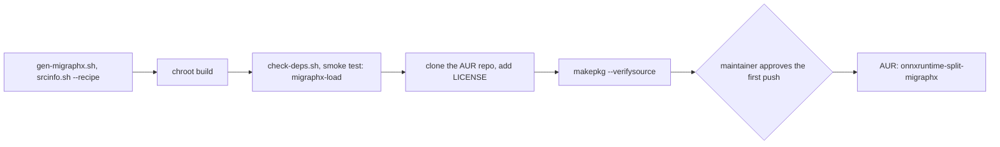

# Releasing the MIGraphX line

This page is the maintainer's procedure for the MIGraphX line: the provider `onnxruntime-provider-migraphx` (for AMD GPUs; see [amd.md](amd.md)) and its Python add-on `python-onnxruntime-provider-migraphx`. Both come from one pkgbase, `onnxruntime-split-migraphx`, with its own `pkgrel`. The one-time setup and the main line's procedure are in [release.md](release.md). Read them first.

Unlike the main and CUDA 12 lines, this line is **source only**: no GitHub release, no assets, no `-bin` pkgbase. `scripts/gen-bin.sh` refuses the package, because a prebuilt binary would be published without anyone having run it on AMD hardware. Its PKGBUILD is generated from `onnxruntime-split/PKGBUILD`, and you never edit it by hand. The commands below are for version `1.29.0-1`.



## When to release it

The provider loads into the main line's core and is built with the same training and NCCL options. It therefore follows the main line's interface, not its every release ([the joint release rule](release.md#joint-release)). The provider depends on `onnxruntime-core>=1.29.0-7` and `onnxruntime-core<1.29.1`. The add-on has no version of its own: it is released with the provider, at the provider's version. Release them:

- with the main line's 1.29.0-7, for the first time (version 1.29.0-1);
- again, as a new `line_pkgrel` in `scripts/gen-migraphx.sh`, when the main line raises `_ortf_core_abi_pkgrel` (a change of the core-to-provider interface), or when this line alone changes (a ROCm bound, a description);
- not for a main-line release that only changes packaging.

A ROCm upgrade past the bound (`migraphx` and `hip-runtime-amd` are bounded to the major of the packages the build used) needs a rebuild and a `line_pkgrel` bump, as a vendor bump does in [release.md](release.md#later-releases).

## 1. Regenerate

Regenerate after any change to `onnxruntime-split/PKGBUILD`. The generated recipe differs from it only in a few input lines, a header comment and the `pkgrel`:

```bash
scripts/gen-migraphx.sh                                          # writes onnxruntime-split-migraphx/PKGBUILD
scripts/srcinfo.sh --recipe onnxruntime-split-migraphx --write   # its .SRCINFO
```

These two commands fail when either file is stale. `scripts/test.sh` runs both:

```bash
scripts/gen-migraphx.sh --check
scripts/srcinfo.sh --recipe onnxruntime-split-migraphx --check
```

The generator stamps `pkgbase`, `_ortf_default_eps='migraphx'`, `_ortf_default_python=0`, `_ortf_default_nccl=1`, `_ortf_line=migraphx` and the line's `pkgrel`.

## 2. Build in a clean chroot

The recipe's `makedepends` are `migraphx`, `hip-runtime-amd` and `rccl`, all in Arch's `extra`, so a plain chroot build needs no `-I` file:

```bash
cd onnxruntime-split-migraphx
extra-x86_64-build
```

The chroot installs the ROCm packages, about 8 GiB (an estimate; `migraphx` alone is 1153.48 MiB installed). The line builds the MIGraphX provider and its add-on, and no Python module: `prepare()` stops for an `ORTF_EPS` other than `migraphx` and for `ORTF_PYTHON=1`. Its NCCL is AMD's `rccl`, a build input only (the provider links none).

Whether CMake's `find_package(hip)` needs more ROCm packages than these three is settled by the first chroot build. If it fails on a missing one, add it to the recipe's `makedepends` through `onnxruntime-split/PKGBUILD` and regenerate, never in the generated file.

## 3. Check

```bash
scripts/check-deps.sh onnxruntime-split-migraphx/onnxruntime-provider-migraphx-1.29.0-1-x86_64.pkg.tar.zst
d=$(mktemp -d) && bsdtar -xf onnxruntime-split-migraphx/onnxruntime-provider-migraphx-1.29.0-1-x86_64.pkg.tar.zst -C "$d" usr/lib/libonnxruntime_providers_migraphx.so \
  && readelf -d "$d"/usr/lib/libonnxruntime_providers_migraphx.so | grep NEEDED
```

The `NEEDED` list should show `libmigraphx_c.so.3` and `libamdhip64.so.7` among the system libraries, and nothing from CUDA or `librccl`. The recipe expects these sonames, and they are **unconfirmed until the first build**. A different soname means the dependency bounds and the docs ([amd.md](amd.md#the-package)) need review. `check-deps.sh` needs `migraphx` and `hip-runtime-amd` installed to resolve the libraries. Read its flags as in [release-cuda12.md](release-cuda12.md#4-check-the-package-file).

The add-on contains no library, so `check-deps.sh` has nothing to check in it. Its listing should show only directories and one symbolic link, to `/usr/lib/libonnxruntime_providers_migraphx.so`, under `usr/lib/python<minor>/site-packages/onnxruntime/capi/`:

```bash
bsdtar -tvf onnxruntime-split-migraphx/python-onnxruntime-provider-migraphx-1.29.0-1-x86_64.pkg.tar.zst
```

Its dependencies are the provider, `python-onnxruntime-core` and `python`, bounded to that minor ([dependencies.md](dependencies.md#what-each-package-depends-on)).

Then, on a machine with the main line's core 1.29.0-7 and the provider installed, run the load test ([the smoke test](../tools/ort-smoke/README.md#the-two-newest-targets)):

```bash
scripts/smoke-test.sh --only cpu,migraphx-load
```

On a machine without an AMD GPU the pass is `ok (no device)`: the provider library loaded and failed cleanly, with no crash. Nothing here shows that a model runs on an AMD GPU. That is what the [report](amd.md#reporting-a-result) is for.

## 4. Clone the AUR repository and add the licence

The pkgbase is new, so the clone is an empty repository, as in [One-time setup](release.md#one-time-setup). The AUR repository carries a 0BSD `LICENSE` for the packaging files, as the others do. Copy it in from there, to be committed with the first push:

```bash
git clone ssh://aur@aur.archlinux.org/onnxruntime-split-migraphx.git aur/onnxruntime-split-migraphx
cp aur/onnxruntime-split/LICENSE aur/onnxruntime-split-migraphx/
```

## 5. Verify the sources and push to the AUR

```bash
scripts/srcinfo.sh --recipe onnxruntime-split-migraphx --aur aur/onnxruntime-split-migraphx
(cd aur/onnxruntime-split-migraphx && SRCDEST="$PWD/../../onnxruntime-split-migraphx" makepkg --verifysource)   # drop SRCDEST=... when makepkg.conf sets it
```

`--verifysource` checks every source against the sums the recipe holds, the ONNX Runtime source archive of the mirror included ([the source mirror](release.md#the-source-mirror); [release-cuda12.md](release-cuda12.md#7-verify-the-sources-and-push-to-the-aur) explains the `SRCDEST`). Optionally run `namcap` on the PKGBUILD.

**The first push of this new pkgbase needs the maintainer's approval, after the maintainer has seen the recipe.** No script in this repository pushes, and the push of a new AUR package base is a public act that cannot be taken back. When approved:

```bash
(cd aur/onnxruntime-split-migraphx && git add LICENSE PKGBUILD .SRCINFO && git commit -m '1.29.0-1' && git push)
```

The AUR branch is `master`. Later releases are the same push with the new version in the message and no approval of a new pkgbase.

## After a user confirms it works

The packages stay labelled "untested on AMD hardware" (the provider's `pkgdesc`, which is the recipe's, and these docs) until an AMD user confirms it with a report ([amd.md](amd.md#reporting-a-result)). Removing the label is a change to `onnxruntime-split/PKGBUILD` and the docs, then a regeneration and a `line_pkgrel` bump. The maintainer decides when.
