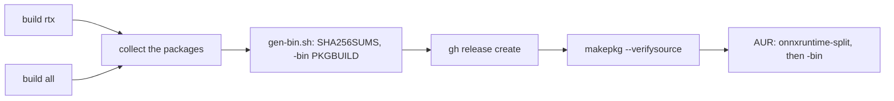
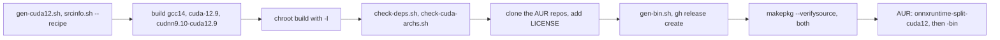

# Releasing

The maintainer's procedure for a release: build the packages in a clean chroot, publish them as GitHub release assets, and update the two AUR packages, `onnxruntime-split` (the recipe) and `onnxruntime-split-bin` (the prebuilt packages, which download those assets). The CUDA 12 legacy line is released separately, with two AUR packages of its own: [section 6](#6-the-cuda-12-legacy-line). Users of the packages need none of this: see [install.md](install.md#prebuilt-packages). The commands below are for the release of version `1.29.0-6`; replace the version for another.



What is released: the five packages of the `rtx` build (the recipe as committed: `onnxruntime-core`, `onnxruntime-provider-cuda13-rtx`, `onnxruntime-provider-tensorrt-cuda13`, `onnxruntime-provider-openvino` and `python-onnxruntime-core`) and the CUDA package of an `all` build (`onnxruntime-provider-cuda13-all`). Nothing else, and no MIGraphX package: it has never run on AMD hardware. No package contains a vendor library; the vendor runtimes are dependencies ([README](../README.md#licence-and-redistribution)).

## One-time setup

1. The chroot tools:

   ```bash
   sudo pacman -S --needed devtools
   ```

2. The builder's identity and flags, in `~/.config/pacman/makepkg.conf`:

   ```bash
   PACKAGER='Raul Dias <raul@dias.com.br>'
   MAKEFLAGS='-j8'
   SRCDEST=/path/with/space/sources   # shares the 1.6 GiB ONNX Runtime clone between builds
   ```

   `makechrootpkg` copies `PACKAGER` and `MAKEFLAGS` into the chroot and builds in `/build`, so a package's `.BUILDINFO` has `builddir = /build` and no `/home` path. Check a built package with:

   ```bash
   bsdtar -xOf <package file> .BUILDINFO | grep -E '^(packager|builddir)'
   ```

   (This setup was not verified on the machine that wrote this page: `devtools` was not installed there. Run the check on the first build.)

3. The AUR clones, with an AUR account whose SSH key is registered. Cloning a pkgbase that does not exist yet gives an empty repository. Clone them before the first `gen-bin.sh`, which writes into `aur/onnxruntime-split-bin` (`aur/` is not tracked by this repository):

   ```bash
   git clone ssh://aur@aur.archlinux.org/onnxruntime-split.git aur/onnxruntime-split
   git clone ssh://aur@aur.archlinux.org/onnxruntime-split-bin.git aur/onnxruntime-split-bin
   ```

   Each AUR repository also carries a `LICENSE` file, the 0BSD licence of the packaging files (the commit "Add a 0BSD licence for the packaging files"). The commands below add only `PKGBUILD` and `.SRCINFO`, so it stays as it is; a new pkgbase needs it copied in before its first push ([section 6](#6-the-cuda-12-legacy-line)).

4. `extra-x86_64-build` creates `/var/lib/archbuild/extra-x86_64` on first use (needs `sudo`; several GiB, since the chroot installs `cuda`, `cudnn` and `openvino`).

## 1. Build the rtx packages

The recipe as committed (its defaults are the engines `cuda tensorrt openvino`, the CUDA preset `rtx`, and Python):

```bash
cd onnxruntime-split
extra-x86_64-build -- -I /path/to/nvidia-tensorrt-sdk-local-<ver>-x86_64.pkg.tar.zst
```

A chroot cannot fetch AUR packages, so the TensorRT package (`makedepends` has `tensorrt`, which both the AUR's `tensorrt` and `nvidia-tensorrt-sdk-local` provide) is passed to `makechrootpkg` with `-I`: a built `nvidia-tensorrt-sdk-local` package, or a built AUR `tensorrt` package. Pass it again for every build.

## 2. Build the all CUDA package

The environment does not reach makepkg in a chroot, so the `all` preset is set in a copy of the PKGBUILD, in an empty directory (the committed PKGBUILD and `.SRCINFO` stay as they are):

```bash
w=$(mktemp -d) && cp onnxruntime-split/PKGBUILD "$w"/ \
  && sed -i 's/^_ortf_default_cuda_archs=.*/_ortf_default_cuda_archs=all/' "$w"/PKGBUILD \
  && (cd "$w" && extra-x86_64-build -- -I /path/to/nvidia-tensorrt-sdk-local-<ver>-x86_64.pkg.tar.zst)
```

Only its CUDA package, `onnxruntime-provider-cuda13-all-1.29.0-6-x86_64.pkg.tar.zst`, is released. Its other packages are not released: the `rtx` build's own are used with it (the TensorRT package depends on `onnxruntime-provider-cuda13`, a name both CUDA packages provide).

## 3. Check

```bash
scripts/check-deps.sh <package files>
```

Run it on the files of both builds ([what it reports](install.md#checking-built-packages-scriptscheck-depssh)); nothing should be flagged. Then install the `rtx` packages and run the smoke test ([install.md, Verify](install.md#4-verify); the options are in the [smoke test README](../tools/ort-smoke/README.md)):

```bash
scripts/smoke-test.sh --require cpu,cuda,tensorrt,openvino:CPU,openvino:GPU,openvino:NPU
```

## 4. Collect, generate, publish

The order matters: `SHA256SUMS` and the `-bin` PKGBUILD come from `gen-bin.sh`, which the release command needs, and the check of the `-bin` PKGBUILD needs the uploaded assets.

1. Put the six packages in an otherwise empty directory (the `rtx` build's five and the `all` CUDA package), nothing else: `gen-bin.sh` refuses a package from another version or pkgbase and skips debug packages.

2. Generate:

   ```bash
   scripts/gen-bin.sh <dir> v1.29.0-6
   ```

   It writes `<dir>/SHA256SUMS` and `aur/onnxruntime-split-bin/{PKGBUILD,.SRCINFO}`, and prints the `gh release create` command. It refuses, naming the cause, an asset that is not from this recipe at the tag's version, a MIGraphX package, and a dependency a `-bin` package would not meet.

3. Create the release with that command's form, adding a title and notes:

   ```bash
   gh release create v1.29.0-6 <dir>/*.pkg.tar.zst <dir>/SHA256SUMS \
     --repo rsd/omarchy-onnxruntime --title '...' --notes '...'
   ```

4. Check the generated PKGBUILD against the uploaded assets: `makepkg` downloads them and compares them with the sums it holds.

   ```bash
   (cd aur/onnxruntime-split-bin && makepkg --verifysource)
   ```

## 5. Push to the AUR

The source package first, then the prebuilt one, which downloads assets that must already be public. The AUR branch is `master`. Optionally run `namcap` on both PKGBUILDs first.

```bash
scripts/srcinfo.sh --aur aur/onnxruntime-split          # checks .SRCINFO is current, then copies PKGBUILD and .SRCINFO
(cd aur/onnxruntime-split && git add PKGBUILD .SRCINFO && git commit -m '1.29.0-6' && git push)

(cd aur/onnxruntime-split-bin && git add PKGBUILD .SRCINFO && git commit -m '1.29.0-6' && git push)
```

`scripts/srcinfo.sh --aur` commits nothing and fails when the committed `onnxruntime-split/.SRCINFO` is stale: regenerate it with `scripts/srcinfo.sh --write` after a PKGBUILD change.

## 6. The CUDA 12 legacy line

The package `onnxruntime-provider-cuda12-legacy` (the CUDA provider built with CUDA 12.9 for Pascal and Volta; [engines.md](engines.md#nvidia-pascal-and-volta-cuda-12-legacy-packaged-untested)) has its own pkgbase, `onnxruntime-split-cuda12`, its own prebuilt pkgbase, `onnxruntime-split-cuda12-bin`, its own `pkgrel` and its own GitHub release. Its PKGBUILD is generated from `onnxruntime-split/PKGBUILD`; never edit it by hand. It is released with the same `pkgver` as the main line, and the commands below are for `cuda12-v1.29.0-1`.



1. **Regenerate** after any change to `onnxruntime-split/PKGBUILD` (the generated recipe differs from it only in a few input lines, a header comment and the `pkgrel`), and after a rebuild of this line alone, which is a new `cuda12_pkgrel` in `scripts/gen-cuda12.sh`:

   ```bash
   scripts/gen-cuda12.sh                                          # writes onnxruntime-split-cuda12/PKGBUILD
   scripts/srcinfo.sh --recipe onnxruntime-split-cuda12 --write   # its .SRCINFO
   ```

   `scripts/gen-cuda12.sh --check` and `scripts/srcinfo.sh --recipe onnxruntime-split-cuda12 --check` fail when either is stale; `scripts/test.sh` runs both.

2. **Build the CUDA 12 userland and `gcc14`** from the AUR with `makepkg`, outside the chroot. The recipe's build uses GCC 14 end to end, because the `cuda-12.9` package sets nvcc's host compiler to `g++-14` and the recipe compiles its C++ with that compiler; Arch's `gcc` stays as it is. The three packages are `gcc14`, `cuda-12.9` and `cudnn9.10-cuda12.9`. `gcc14` is a long build. They are third-party AUR packages: read their PKGBUILDs. `cuda-12.9` conflicts with `cuda` and depends on `gcc14`, so build `gcc14` first, and keep the three package files: the chroot installs them from those files.

3. **Build in a clean chroot**, passing the three with `-I`, as the TensorRT package is passed in [1](#1-build-the-rtx-packages). A chroot cannot fetch AUR packages, and the recipe's `makedepends` name these three explicitly (`gcc14`, `cuda-12.9` and `cudnn9.10-cuda12.9`, not a bare `cuda` and `cudnn`, which an AUR helper would resolve to Arch's CUDA 13 and cuDNN 9.11 or later), so the `-I` files meet them:

   ```bash
   cd onnxruntime-split-cuda12
   extra-x86_64-build -- -I /path/to/gcc14-<ver>-x86_64.pkg.tar.zst \
     -I /path/to/cuda-12.9-<ver>-x86_64.pkg.tar.zst \
     -I /path/to/cudnn9.10-cuda12.9-<ver>-x86_64.pkg.tar.zst
   ```

   The recipe builds the CUDA provider alone (no TensorRT, OpenVINO or Python package). `prepare()` refuses a toolkit that is not CUDA 12, and `package()` fails the build on a CUDA library with a `.so.13` soname or a CUDA provider that does not link `libcudart.so.12`, `libcublas.so.12` and `libcublasLt.so.12`.

4. **Check** the package file:

   ```bash
   scripts/check-deps.sh onnxruntime-split-cuda12/onnxruntime-provider-cuda12-legacy-1.29.0-1-x86_64.pkg.tar.zst \
     /path/to/cuda-12.9-<ver>-x86_64.pkg.tar.zst /path/to/cudnn9.10-cuda12.9-<ver>-x86_64.pkg.tar.zst
   scripts/check-cuda-archs.sh [--cuobjdump /path/to/cuda-12.9/bin/cuobjdump] \
     onnxruntime-split-cuda12/onnxruntime-provider-cuda12-legacy-1.29.0-1-x86_64.pkg.tar.zst \
     60 61 70 75 80 86 89 90 120 60-virtual
   ```

   The list has `90` because ONNX Runtime compiles 18 kernels for `sm_90a` whatever `ORTF_CUDA_ARCHS` says (the CUDA 13 packages have them too).

   `check-deps.sh` compares the package with what is installed. On a machine whose `cuda` and `cudnn` are CUDA 13, nothing installed meets `cuda>=12`, `cuda<13` or `cudnn<9.11`; the two package files given after the provider count as meeting them by their provides. The library rows resolve through the host's `ldconfig` cache, so a host without the CUDA 12 userland installed can show the CUDA 12 libraries as `UNRESOLVED` or `GAP`; read the flags with that in mind, or run it on a machine that has `cuda-12.9` and `cudnn9.10-cuda12.9` installed. `check-cuda-archs.sh` fails unless the library holds exactly the SASS of those architectures and one PTX (`compute_60`, the oldest architecture built: a preset's PTX is always that of its oldest); `--cuobjdump` points it at the `cuobjdump` of a CUDA 12.9 toolkit, where the host's is another version. The package conflicts with every CUDA 13 package, so run the smoke test on a machine set up as in [install.md](install.md#older-nvidia-gpus-pascal-and-volta-cuda-12).

   `prepare()` of this line refuses a cuDNN other than 9.10 ("the CUDA 12 legacy line needs cuDNN 9.10 (found 9.11)"), because cuDNN 9.11 dropped Pascal and Volta; the main line is not bound by it.

5. **Clone the two AUR repositories and add the licence**, before `gen-bin.sh` writes into `aur/onnxruntime-split-cuda12-bin` (a clone into a directory that is not empty fails). The two pkgbases are new, so the clones are empty repositories, as in [One-time setup](#one-time-setup). Each AUR repository carries a 0BSD `LICENSE` for the packaging files, as the main line's two do; copy it in from there, to be committed with the first push:

   ```bash
   git clone ssh://aur@aur.archlinux.org/onnxruntime-split-cuda12.git aur/onnxruntime-split-cuda12
   git clone ssh://aur@aur.archlinux.org/onnxruntime-split-cuda12-bin.git aur/onnxruntime-split-cuda12-bin
   cp aur/onnxruntime-split/LICENSE aur/onnxruntime-split-cuda12/
   cp aur/onnxruntime-split/LICENSE aur/onnxruntime-split-cuda12-bin/
   ```

6. **Generate the `-bin` recipe and publish.** The `cuda12-` tag selects the CUDA 12 line: every asset must come from pkgbase `onnxruntime-split-cuda12`, a set that mixes it with the main line's is refused, and the pin `onnxruntime-core=<pkgver>` is accepted, because the main line's core meets it.

   ```bash
   mkdir ~/release-cuda12 && cp onnxruntime-split-cuda12/onnxruntime-provider-cuda12-legacy-1.29.0-1-x86_64.pkg.tar.zst ~/release-cuda12/
   scripts/gen-bin.sh ~/release-cuda12 cuda12-v1.29.0-1
   gh release create cuda12-v1.29.0-1 ~/release-cuda12/*.pkg.tar.zst ~/release-cuda12/SHA256SUMS \
     --repo rsd/omarchy-onnxruntime --title '...' --notes '...'
   ```

   `gen-bin.sh` writes `~/release-cuda12/SHA256SUMS` and `aur/onnxruntime-split-cuda12-bin/{PKGBUILD,.SRCINFO}`. The tag scheme is `cuda12-v<pkgver>-<pkgrel>`, apart from the main line's `v<pkgver>-<pkgrel>`.

7. **Verify the sources and push to the AUR**, the source package first, as in [5](#5-push-to-the-aur). `makepkg --verifysource` checks each recipe's sources against the sums it holds. The `-bin` one downloads the release's asset. The source recipe's sources include the 1.6+ GiB ONNX Runtime clone. The one-time setup assumes `SRCDEST` in `~/.config/pacman/makepkg.conf`, which makes `makepkg` reuse the clone of your builds; without it, `makepkg --verifysource` in `aur/onnxruntime-split-cuda12` clones the whole tree again. If `makepkg.conf` does not set it, point `SRCDEST` at the directory that holds the existing clone and zips, here the recipe directory `onnxruntime-split-cuda12` (an absolute path):

   ```bash
   (cd aur/onnxruntime-split-cuda12-bin && makepkg --verifysource)

   scripts/srcinfo.sh --recipe onnxruntime-split-cuda12 --aur aur/onnxruntime-split-cuda12
   (cd aur/onnxruntime-split-cuda12 && SRCDEST="$PWD/../../onnxruntime-split-cuda12" makepkg --verifysource)   # drop SRCDEST=... when makepkg.conf sets it
   (cd aur/onnxruntime-split-cuda12 && git add LICENSE PKGBUILD .SRCINFO && git commit -m '1.29.0-1' && git push)

   (cd aur/onnxruntime-split-cuda12-bin && git add LICENSE PKGBUILD .SRCINFO && git commit -m '1.29.0-1' && git push)
   ```

**The core pin.** The provider depends on `onnxruntime-core=<pkgver>`, any pkgrel, and not on the core of its own build, because the core links no CUDA library and the provider has no version handshake with it: what the two share is ONNX Runtime's version and the layout-relevant build defines (`DISABLE_*`, `ENABLE_*`, the C++ standard, `_GLIBCXX_USE_CXX11_ABI`). A core that changes one of those would break the provider without any dependency noticing. The rule is therefore:

- **A main-line release that changes `cmake` flags or patches** also rebuilds and re-tests the CUDA 12 line, as a new `cuda12_pkgrel` released under a new tag.
- **A main-line release that only changes packaging** (dependencies, descriptions, licence files, a vendor bound) does not.

**When ONNX Runtime drops CUDA 12.** Upstream has deprecated CUDA 12 since 1.27. When the main line's ONNX Runtime moves past the last version that builds with it, this line stays at that version and is not rebuilt, because a provider built for one ONNX Runtime version cannot follow a newer core. Continuing it past that point would need its own versioned core, which is a different design from this one, and the decision belongs before the main line leaves that version.

## Later releases

- **A fix to the `-bin` PKGBUILD alone** (a dependency, a description): bump only its `pkgrel`, with the assets and the release as they are:

  ```bash
  scripts/gen-bin.sh --pkgrel 7 <dir> v1.29.0-6
  ```

  The assets' version still drives the version check and the `<name>=<pkgver>-<pkgrel>` provides. Verify and push as in [4](#4-collect-generate-publish) and [5](#5-push-to-the-aur), without a new release.
- **A change to the packages** needs a rebuild, a new `pkgrel` in `onnxruntime-split/PKGBUILD`, a new `.SRCINFO` and a new release (a new tag). Whether the CUDA 12 line is rebuilt with it depends on the change: [the core pin](#6-the-cuda-12-legacy-line).
- **A vendor bump past a dependency bound** (OpenVINO 2026.5, Python 3.15, a new TensorRT minor, and so on; [the bounds](install.md#dependencies-and-version-bounds)) makes pacman refuse the vendor upgrade until the packages are rebuilt: rebuild against the new version, bump `pkgrel`, and release again. `scripts/check-deps.sh` on the released files shows when one is due.
