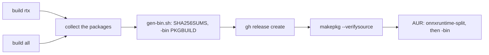

# Releasing

This page is the maintainer's procedure for a release. You build the packages in a clean chroot, publish them as GitHub release assets, and update the two AUR packages: `onnxruntime-split` (the recipe) and `onnxruntime-split-bin` (the prebuilt packages, which download those assets). Users of the packages need none of this: see [INSTALL.md](../INSTALL.md#prebuilt-packages).

The CUDA 12 line is released separately, with two AUR packages of its own ([section 6](#6-the-cuda-12-legacy-line)), but **together with the main line** ([joint release](#joint-release)). The MIGraphX line is an AUR source package only ([section 7](#7-the-migraphx-line)). Terms such as pkgbase, `-bin` and clean chroot are in the [glossary](glossary.md).

The commands below are for the release of version `1.29.0-7` (`pkgver` 1.29.0, `pkgrel` 7). Replace the version for another.



What is released: the six packages of the `rtx` build, and the CUDA package of an `all` build.

- The `rtx` build is the recipe as committed: `onnxruntime-core`, `onnxruntime-provider-cuda13-rtx`, `onnxruntime-provider-tensorrt-cuda13`, `onnxruntime-provider-openvino`, `onnxruntime-provider-dnnl` and `python-onnxruntime-core`.
- The `all` build contributes `onnxruntime-provider-cuda13-all`.

Nothing else is released:

- No MIGraphX package, provider or add-on. The provider has never run on AMD hardware, and `gen-bin.sh` refuses the line.
- No `-nccloff` package. A build with `ORTF_NCCL=0` is for local use.

No package contains a vendor library. The vendor runtimes are dependencies ([README](../README.md#licence-and-redistribution)).

Before releasing:

1. Run `scripts/test.sh` ([testing.md](testing.md)).
2. Run `scripts/check-upstream.sh` ([below](#the-source-mirror)). It says whether upstream is back, and the release needs the source mirror published.
3. If the PKGBUILD changed, regenerate and check the `.SRCINFO`: `scripts/srcinfo.sh --write`, then `scripts/srcinfo.sh --check`.

## Joint release

Training and NCCL change the interface between `onnxruntime-core` and a provider library. A provider built without them crashes in a core built with them, and nothing checks that both agree. Hence the rule for 1.29.0:

- **The main line 1.29.0-7 and the CUDA 12 line 1.29.0-2 are built and released together**, so that a user who upgrades the core never meets a CUDA 12 provider of the old interface. The core 1.29.0-7 conflicts with `onnxruntime-provider-cuda12-legacy` and `onnxruntime-provider-cuda12-legacy-bin` below `1.29.0-2`, so pacman refuses that mix. Do the main line's [sections 1 to 5](#1-build-the-rtx-packages) and the CUDA 12 line's ([release-cuda12.md](release-cuda12.md)) in the same release round. Push the CUDA 12 packages after the main line's.
- **The CUDA 12 and MIGraphX providers pin the core by a pair**: `onnxruntime-core>=<pkgver>-<N>` and `onnxruntime-core<<next patch release>` (`>=1.29.0-7`, `<1.29.1`). `N` is `_ortf_core_abi_pkgrel` in `onnxruntime-split/PKGBUILD`: the first pkgrel of the `pkgver` whose core has the plug these providers are built for. It is 7 for 1.29.0. A later packaging-only pkgrel of the main line (`1.29.0-8`) still satisfies the pair, and needs no rebuild of the other lines. `_ortf_core_abi_pkgrel` goes back to 1 with a new `pkgver`.
- **A main-line change that alters the interface again** (a flag such as training or NCCL, or a patch to the provider bridge) raises `_ortf_core_abi_pkgrel` to that pkgrel. The other lines then need rebuilding and releasing with it: see [the core pin](release-cuda12.md#the-core-pin).
- **The main line's own providers** depend on the exact `onnxruntime-core=<pkgver>-<pkgrel>` of the build, so they need nothing extra.

`scripts/gen-bin.sh` enforces the pair for the CUDA 12 line's assets. It refuses `cuda12-v1.29.0-1` and the bare pin `onnxruntime-core=1.29.0`, which fit the cores from before 1.29.0-7 ([release-cuda12.md](release-cuda12.md#6-generate-the--bin-recipe-and-publish)).

## The source mirror

`github.com/microsoft/onnxruntime` has returned 404 since 2026-11-17. By default the recipes therefore build from `onnxruntime-<pkgver>.tar.gz`, an asset of the release `source-v<pkgver>` of this repository (`ORTF_SOURCE=mirror`: [build.md](build.md#the-onnx-runtime-source-mirror-or-upstream)). One archive serves all three recipes. It is not a package and has no `pkgrel`. Building from it instead of the git tag is a change of source location, not a rebuild, so it did not bump the release version.

**Make and publish it before the recipe's release.** The recipe's `source` and `b2sums` name it, so `makepkg --verifysource` and every user's build fail until the asset is public. For `1.29.0` it is published. For a new `pkgver` ([below](#later-releases)), do this first, from a clone of `microsoft/onnxruntime` that has the commit. `onnxruntime-split/onnxruntime` is makepkg's clone of an earlier build and the script's default `--repo`:

```bash
scripts/make-source-archive.sh --out /path/to/outdir
```

The script reads `pkgver` and `_ortf_commit` from `onnxruntime-split/PKGBUILD`. It refuses (exit 1, nothing written) unless the tag `v<pkgver>` in the repository resolves to that commit. It writes:

- the archive (`git archive --format=tar --prefix=onnxruntime-<pkgver>/ <commit> | gzip -n -9`, the same bytes on every run);
- `onnxruntime-<pkgver>.tar.gz.sha256`;
- `PROVENANCE.md`.

It prints the sha256, the b2sum and the size, and the `gh release create` command without running it.

Then:

1. Put the b2sum in the PKGBUILD as `_ortf_tree_b2sum` of the mirror's branch. The upstream branch's is the git tag's tree, which step 4 of `PROVENANCE.md` shows how to compute.
2. Regenerate the CUDA 12 and MIGraphX recipes and the three `.SRCINFO` files as usual.
3. Publish, from the output directory:

   ```bash
   gh release create source-v1.29.0 --repo rsd/omarchy-onnxruntime --latest=false \
     --title 'ONNX Runtime 1.29.0 source (mirror)' --notes-file PROVENANCE.md \
     onnxruntime-1.29.0.tar.gz onnxruntime-1.29.0.tar.gz.sha256
   ```

`--latest=false` keeps the release from becoming the repository's latest. The package releases, `v<pkgver>-<pkgrel>`, are what the prebuilt recipes and users look for. The release notes are `PROVENANCE.md`, which tells anyone how to verify the archive against upstream's commit.

**Watch for upstream's return.** Run `scripts/check-upstream.sh` before each release, and from time to time while the mirror is the default. It runs `git ls-remote` for the tag `v<pkgver>` with no credentials and no prompts, and it ignores the git configuration of the user running it (no `insteadOf`, no stored credentials, no SSH). The exit status says what to do:

| Exit | Meaning | What to do |
|---|---|---|
| 0 | Upstream answers, and `v<pkgver>` is `_ortf_commit` | Switching `_ortf_default_source` back to `upstream` is possible. It is the maintainer's decision, never automatic |
| 1 | Upstream answers, but the tag is missing or points at another commit (the output says which) | Do not switch. A moved tag is different source: investigate |
| 3 | Still gone, or no network (the two are not told apart; git's error line is printed) | Keep the mirror |
| 2 | Usage error, or the PKGBUILD cannot be read | Fix the call |

`scripts/test.sh` tests both scripts without the network ([testing.md](testing.md)).

## One-time setup

1. Install the chroot tools:

   ```bash
   sudo pacman -S --needed devtools
   ```

2. Set the builder's identity and flags in `~/.config/pacman/makepkg.conf`:

   ```bash
   PACKAGER='Your Name <you@example.org>'
   MAKEFLAGS='-j8'
   SRCDEST=/path/with/space/sources   # shares the source archive (264 MiB; with ORTF_SOURCE=upstream the 1.6 GiB clone) and the dependency zips between builds
   ```

   `makechrootpkg` copies `PACKAGER` and `MAKEFLAGS` into the chroot and builds in `/build`, so a package's `.BUILDINFO` has `builddir = /build` and no `/home` path. Check a built package with:

   ```bash
   bsdtar -xOf <package file> .BUILDINFO | grep -E '^(packager|builddir)'
   ```

   This is not yet verified end to end. Run the check on the first release build.

3. Clone the AUR repositories. You need an AUR account whose SSH key is registered. Cloning a pkgbase that does not exist yet gives an empty repository. Clone them before the first `gen-bin.sh`, which writes into `aur/onnxruntime-split-bin` (`aur/` is not tracked by this repository):

   ```bash
   git clone ssh://aur@aur.archlinux.org/onnxruntime-split.git aur/onnxruntime-split
   git clone ssh://aur@aur.archlinux.org/onnxruntime-split-bin.git aur/onnxruntime-split-bin
   ```

   Each AUR repository also carries a `LICENSE` file with the 0BSD licence of the packaging files. The commands below add only `PKGBUILD` and `.SRCINFO`, so it stays as it is. A new pkgbase needs it copied in before its first push ([section 6](#6-the-cuda-12-legacy-line)).

4. `extra-x86_64-build` creates `/var/lib/archbuild/extra-x86_64` on first use. It needs `sudo` and several GiB, since the chroot installs `cuda`, `cudnn`, `nccl` and `openvino`.

## 1. Build the rtx packages

The recipe as committed has the engines `cuda tensorrt openvino dnnl`, the CUDA preset `rtx`, and Python and NCCL on by default:

```bash
cd onnxruntime-split
extra-x86_64-build -- -I /path/to/nvidia-tensorrt-sdk-local-<ver>-x86_64.pkg.tar.zst
```

A chroot cannot fetch AUR packages, so pass the TensorRT package to `makechrootpkg` with `-I`. The recipe's `makedepends` has `tensorrt`, which both the AUR's `tensorrt` and `nvidia-tensorrt-sdk-local` provide. Pass a built `nvidia-tensorrt-sdk-local` package, or a built AUR `tensorrt` package. Pass it again for every build. The packages are written to `onnxruntime-split/`.

## 2. Build the all CUDA package

The environment does not reach makepkg in a chroot, so set the `all` preset in a copy of the PKGBUILD, in an empty directory. The committed PKGBUILD and `.SRCINFO` stay as they are:

```bash
w=$(mktemp -d) && cp onnxruntime-split/PKGBUILD "$w"/ \
  && sed -i 's/^_ortf_default_cuda_archs=.*/_ortf_default_cuda_archs=all/' "$w"/PKGBUILD \
  && (cd "$w" && extra-x86_64-build -- -I /path/to/nvidia-tensorrt-sdk-local-<ver>-x86_64.pkg.tar.zst)
```

The packages of this build are written to `$w`. Release only its CUDA package, `onnxruntime-provider-cuda13-all-1.29.0-7-x86_64.pkg.tar.zst`. Use the `rtx` build's own packages for the rest (the TensorRT package depends on `onnxruntime-provider-cuda13`, a name both CUDA packages provide).

## 3. Check

```bash
scripts/check-deps.sh <package files>
```

Run it on the files of both builds ([what it reports](dependencies.md#checking-built-packages-scriptscheck-depssh)). Nothing should be flagged. Then install the `rtx` packages and run the smoke test ([INSTALL.md, Check that it works](../INSTALL.md#check-that-it-works); the options are in the [smoke test README](../tools/ort-smoke/README.md)):

```bash
scripts/smoke-test.sh --require cpu,cuda,tensorrt,openvino:CPU,openvino:GPU,openvino:NPU,dnnl
```

## 4. Collect, generate, publish

The order matters. `gen-bin.sh` produces `SHA256SUMS` and the `-bin` PKGBUILD, which the release command needs. The check of the `-bin` PKGBUILD needs the uploaded assets.

1. Put the seven packages in an otherwise empty directory: the `rtx` build's six and the `all` CUDA package. Put nothing else in it. `gen-bin.sh` refuses a package from another version or pkgbase and skips debug packages.

2. Generate:

   ```bash
   scripts/gen-bin.sh <dir> v1.29.0-7
   ```

   It writes `<dir>/SHA256SUMS` and `aur/onnxruntime-split-bin/{PKGBUILD,.SRCINFO}`, and prints the `gh release create` command. It refuses, naming the cause:
   - an asset that is not from this recipe at the tag's version;
   - a MIGraphX package;
   - a `-nccloff` package;
   - a dependency a `-bin` package would not meet.

   `onnxruntime-provider-dnnl` needs no special case: it gets its `-bin` package like the others.

3. Create the release with that command's form, adding a title and notes. Before running it, replace each placeholder: `<dir>` with the directory from step 1, `<title>` with the release title, and `<notes.md>` with the path to a Markdown file of release notes.

   ```bash
   gh release create v1.29.0-7 <dir>/*.pkg.tar.zst <dir>/SHA256SUMS \
     --repo rsd/omarchy-onnxruntime --title "<title>" --notes-file "<notes.md>"
   ```

4. Check the generated PKGBUILD against the uploaded assets. `makepkg` downloads them and compares them with the sums it holds.

   ```bash
   (cd aur/onnxruntime-split-bin && makepkg --verifysource)
   ```

## 5. Push to the AUR

Push the source package first, then the prebuilt one, which downloads assets that must already be public. The AUR branch is `master`. Optionally run `namcap` on both PKGBUILDs first.

```bash
scripts/srcinfo.sh --aur aur/onnxruntime-split          # checks .SRCINFO is current, then copies PKGBUILD and .SRCINFO
(cd aur/onnxruntime-split && git add PKGBUILD .SRCINFO && git commit -m '1.29.0-7' && git push)

(cd aur/onnxruntime-split-bin && git add PKGBUILD .SRCINFO && git commit -m '1.29.0-7' && git push)
```

The source package's `makepkg` downloads the mirror's archive, so the release `source-v<pkgver>` must be public before this push ([the source mirror](#the-source-mirror)). `scripts/srcinfo.sh --aur` commits nothing and fails when the committed `onnxruntime-split/.SRCINFO` is stale. Regenerate it with `scripts/srcinfo.sh --write` after a PKGBUILD change.

## 6. The CUDA 12 legacy line

The package `onnxruntime-provider-cuda12-legacy` ([cuda12-legacy.md](cuda12-legacy.md)) has its own pkgbase, its own prebuilt pkgbase `onnxruntime-split-cuda12-bin`, its own `pkgrel` and its own GitHub release, tagged `cuda12-v<pkgver>-<pkgrel>`. Its release procedure is in [release-cuda12.md](release-cuda12.md): regenerate the recipe, build `gcc14` and the CUDA 12 userland, build in a chroot, check, publish, push.

Version 1.29.0-2 of this line is released together with the main line's 1.29.0-7 ([joint release](#joint-release)). Whether a later main-line release also rebuilds it depends on what changed: [the core pin](release-cuda12.md#the-core-pin).

## 7. The MIGraphX line

The packages `onnxruntime-provider-migraphx` and `python-onnxruntime-provider-migraphx` ([amd.md](amd.md)) are AUR source packages from their own pkgbase, `onnxruntime-split-migraphx`: no GitHub release, no `-bin`. Its procedure is in [release-migraphx.md](release-migraphx.md), including the first push of the new pkgbase, which needs the maintainer's approval.

## Later releases

- **A fix to the `-bin` PKGBUILD alone** (a dependency, a description): bump only its `pkgrel`, with the assets and the release as they are:

  ```bash
  scripts/gen-bin.sh --pkgrel 8 <dir> v1.29.0-7
  ```

  The assets' version still drives the version check and the `<name>=<pkgver>-<pkgrel>` provides. Verify and push as in [4](#4-collect-generate-publish) and [5](#5-push-to-the-aur), without a new release.
- **A change to the packages** needs a rebuild, a new `pkgrel` in `onnxruntime-split/PKGBUILD`, a new `.SRCINFO` and a new release (a new tag). The CUDA 12 and MIGraphX lines are rebuilt with it only when the change alters the interface between the core and the providers, which raises `_ortf_core_abi_pkgrel`: [the core pin](release-cuda12.md#the-core-pin).
- **A vendor bump past a dependency bound** (OpenVINO 2026.5, Python 3.15, a new TensorRT minor, and so on; [the bounds](dependencies.md#the-version-bounds)) makes pacman refuse the vendor upgrade until the packages are rebuilt. Rebuild against the new version, bump `pkgrel`, and release again. `scripts/check-deps.sh` on the released files shows when one is due.
- **A new upstream ONNX Runtime version** is not described here, except that its source mirror comes first. [The source mirror](#the-source-mirror) is made and published before the recipe's release, and the recipe's mirror checksum is the new archive's. `prepare()` checks the source's commit against `_ortf_commit` and each mirrored archive's URL and SHA-1 against `cmake/deps.txt` ([build.md](build.md#dependencies-are-mirrored-not-fetched)), so a bump that misses one fails at the start of the build.
