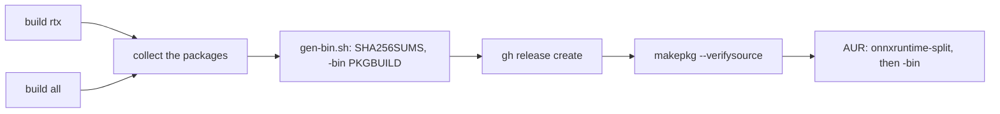

# Releasing

The maintainer's procedure for a release: build the packages in a clean chroot, publish them as GitHub release assets, and update the two AUR packages, `onnxruntime-split` (the recipe) and `onnxruntime-split-bin` (the prebuilt packages, which download those assets). The CUDA 12 line is released separately, with two AUR packages of its own: [section 6](#6-the-cuda-12-legacy-line). Users of the packages need none of this: see [install.md](install.md#prebuilt-packages). Terms such as pkgbase, `-bin` and clean chroot are in the [glossary](glossary.md).

The commands below are for the release of version `1.29.0-6` (`pkgver` 1.29.0, `pkgrel` 6); replace the version for another.



What is released: the five packages of the `rtx` build (the recipe as committed: `onnxruntime-core`, `onnxruntime-provider-cuda13-rtx`, `onnxruntime-provider-tensorrt-cuda13`, `onnxruntime-provider-openvino` and `python-onnxruntime-core`) and the CUDA package of an `all` build (`onnxruntime-provider-cuda13-all`). Nothing else, and no MIGraphX package: it has never run on AMD hardware. No package contains a vendor library; the vendor runtimes are dependencies ([README](../README.md#licence-and-redistribution)).

Before releasing, run `scripts/test.sh` ([testing.md](testing.md)). If the PKGBUILD changed, regenerate and check the `.SRCINFO`: `scripts/srcinfo.sh --write`, then `scripts/srcinfo.sh --check`.

## One-time setup

1. The chroot tools:

   ```bash
   sudo pacman -S --needed devtools
   ```

2. The builder's identity and flags, in `~/.config/pacman/makepkg.conf`:

   ```bash
   PACKAGER='Your Name <you@example.org>'
   MAKEFLAGS='-j8'
   SRCDEST=/path/with/space/sources   # shares the 1.6 GiB ONNX Runtime clone between builds
   ```

   `makechrootpkg` copies `PACKAGER` and `MAKEFLAGS` into the chroot and builds in `/build`, so a package's `.BUILDINFO` has `builddir = /build` and no `/home` path. Check a built package with:

   ```bash
   bsdtar -xOf <package file> .BUILDINFO | grep -E '^(packager|builddir)'
   ```

   Not yet verified end to end: run this check on the first release build.

3. The AUR clones, with an AUR account whose SSH key is registered. Cloning a pkgbase that does not exist yet gives an empty repository. Clone them before the first `gen-bin.sh`, which writes into `aur/onnxruntime-split-bin` (`aur/` is not tracked by this repository):

   ```bash
   git clone ssh://aur@aur.archlinux.org/onnxruntime-split.git aur/onnxruntime-split
   git clone ssh://aur@aur.archlinux.org/onnxruntime-split-bin.git aur/onnxruntime-split-bin
   ```

   Each AUR repository also carries a `LICENSE` file with the 0BSD licence of the packaging files. The commands below add only `PKGBUILD` and `.SRCINFO`, so it stays as it is; a new pkgbase needs it copied in before its first push ([section 6](#6-the-cuda-12-legacy-line)).

4. `extra-x86_64-build` creates `/var/lib/archbuild/extra-x86_64` on first use (needs `sudo`; several GiB, since the chroot installs `cuda`, `cudnn` and `openvino`).

## 1. Build the rtx packages

The recipe as committed (its defaults are the engines `cuda tensorrt openvino`, the CUDA preset `rtx`, and Python):

```bash
cd onnxruntime-split
extra-x86_64-build -- -I /path/to/nvidia-tensorrt-sdk-local-<ver>-x86_64.pkg.tar.zst
```

A chroot cannot fetch AUR packages, so the TensorRT package is passed to `makechrootpkg` with `-I`. The recipe's `makedepends` has `tensorrt`, which both the AUR's `tensorrt` and `nvidia-tensorrt-sdk-local` provide; pass a built `nvidia-tensorrt-sdk-local` package, or a built AUR `tensorrt` package. Pass it again for every build. The packages are written to `onnxruntime-split/`.

## 2. Build the all CUDA package

The environment does not reach makepkg in a chroot, so the `all` preset is set in a copy of the PKGBUILD, in an empty directory (the committed PKGBUILD and `.SRCINFO` stay as they are):

```bash
w=$(mktemp -d) && cp onnxruntime-split/PKGBUILD "$w"/ \
  && sed -i 's/^_ortf_default_cuda_archs=.*/_ortf_default_cuda_archs=all/' "$w"/PKGBUILD \
  && (cd "$w" && extra-x86_64-build -- -I /path/to/nvidia-tensorrt-sdk-local-<ver>-x86_64.pkg.tar.zst)
```

The packages of this build are written to `$w`. Only its CUDA package, `onnxruntime-provider-cuda13-all-1.29.0-6-x86_64.pkg.tar.zst`, is released. Its other packages are not released: the `rtx` build's own are used with it (the TensorRT package depends on `onnxruntime-provider-cuda13`, a name both CUDA packages provide).

## 3. Check

```bash
scripts/check-deps.sh <package files>
```

Run it on the files of both builds ([what it reports](dependencies.md#checking-built-packages-scriptscheck-depssh)); nothing should be flagged. Then install the `rtx` packages and run the smoke test ([install.md, Verify](install.md#4-verify); the options are in the [smoke test README](../tools/ort-smoke/README.md)):

```bash
scripts/smoke-test.sh --require cpu,cuda,tensorrt,openvino:CPU,openvino:GPU,openvino:NPU
```

## 4. Collect, generate, publish

The order matters: `SHA256SUMS` and the `-bin` PKGBUILD come from `gen-bin.sh`, which the release command needs, and the check of the `-bin` PKGBUILD needs the uploaded assets.

1. Put the six packages in an otherwise empty directory (the `rtx` build's five and the `all` CUDA package), nothing else: `gen-bin.sh` refuses a package from another version or pkgbase and skips debug packages.

2. Generate:

   ```bash
   scripts/gen-bin.sh <dir> v1.29.0-6
   ```

   It writes `<dir>/SHA256SUMS` and `aur/onnxruntime-split-bin/{PKGBUILD,.SRCINFO}`, and prints the `gh release create` command. It refuses, naming the cause, an asset that is not from this recipe at the tag's version, a MIGraphX package, and a dependency a `-bin` package would not meet.

3. Create the release with that command's form, adding a title and notes. Before running it, replace each placeholder: `<dir>` with the directory from step 1, `<title>` with the release title, and `<notes.md>` with the path to a Markdown file of release notes.

   ```bash
   gh release create v1.29.0-6 <dir>/*.pkg.tar.zst <dir>/SHA256SUMS \
     --repo rsd/omarchy-onnxruntime --title "<title>" --notes-file "<notes.md>"
   ```

4. Check the generated PKGBUILD against the uploaded assets: `makepkg` downloads them and compares them with the sums it holds.

   ```bash
   (cd aur/onnxruntime-split-bin && makepkg --verifysource)
   ```

## 5. Push to the AUR

The source package first, then the prebuilt one, which downloads assets that must already be public. The AUR branch is `master`. Optionally run `namcap` on both PKGBUILDs first.

```bash
scripts/srcinfo.sh --aur aur/onnxruntime-split          # checks .SRCINFO is current, then copies PKGBUILD and .SRCINFO
(cd aur/onnxruntime-split && git add PKGBUILD .SRCINFO && git commit -m '1.29.0-6' && git push)

(cd aur/onnxruntime-split-bin && git add PKGBUILD .SRCINFO && git commit -m '1.29.0-6' && git push)
```

`scripts/srcinfo.sh --aur` commits nothing and fails when the committed `onnxruntime-split/.SRCINFO` is stale: regenerate it with `scripts/srcinfo.sh --write` after a PKGBUILD change.

## 6. The CUDA 12 legacy line

The package `onnxruntime-provider-cuda12-legacy` ([cuda12-legacy.md](cuda12-legacy.md)) has its own pkgbase, its own prebuilt pkgbase, `onnxruntime-split-cuda12-bin`, its own `pkgrel` and its own GitHub release, tagged `cuda12-v<pkgver>-<pkgrel>`. Its release procedure is in [release-cuda12.md](release-cuda12.md): regenerate the recipe, build `gcc14` and the CUDA 12 userland, build in a chroot, check, publish, push. Whether a main-line release also rebuilds this line depends on what changed: [the core pin](release-cuda12.md#the-core-pin).

## Later releases

- **A fix to the `-bin` PKGBUILD alone** (a dependency, a description): bump only its `pkgrel`, with the assets and the release as they are:

  ```bash
  scripts/gen-bin.sh --pkgrel 7 <dir> v1.29.0-6
  ```

  The assets' version still drives the version check and the `<name>=<pkgver>-<pkgrel>` provides. Verify and push as in [4](#4-collect-generate-publish) and [5](#5-push-to-the-aur), without a new release.
- **A change to the packages** needs a rebuild, a new `pkgrel` in `onnxruntime-split/PKGBUILD`, a new `.SRCINFO` and a new release (a new tag). Whether the CUDA 12 line is rebuilt with it depends on the change: [the core pin](release-cuda12.md#the-core-pin).
- **A vendor bump past a dependency bound** (OpenVINO 2026.5, Python 3.15, a new TensorRT minor, and so on; [the bounds](dependencies.md#the-version-bounds)) makes pacman refuse the vendor upgrade until the packages are rebuilt: rebuild against the new version, bump `pkgrel`, and release again. `scripts/check-deps.sh` on the released files shows when one is due.
- **A new upstream ONNX Runtime version** is not described here. `prepare()` checks the source tag against its commit (`_ortf_commit`) and each mirrored archive's URL and SHA-1 against `cmake/deps.txt` ([build.md](build.md#dependencies-are-mirrored-not-fetched)), so a bump that misses one fails at the start of the build.
